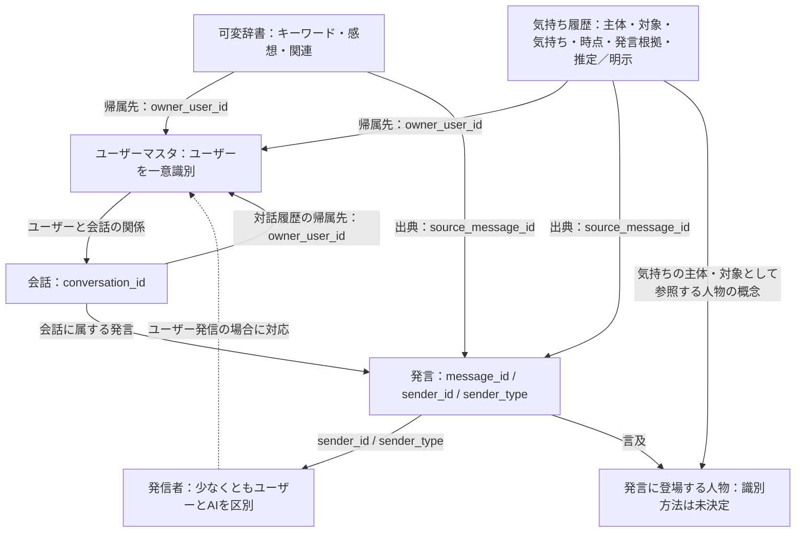
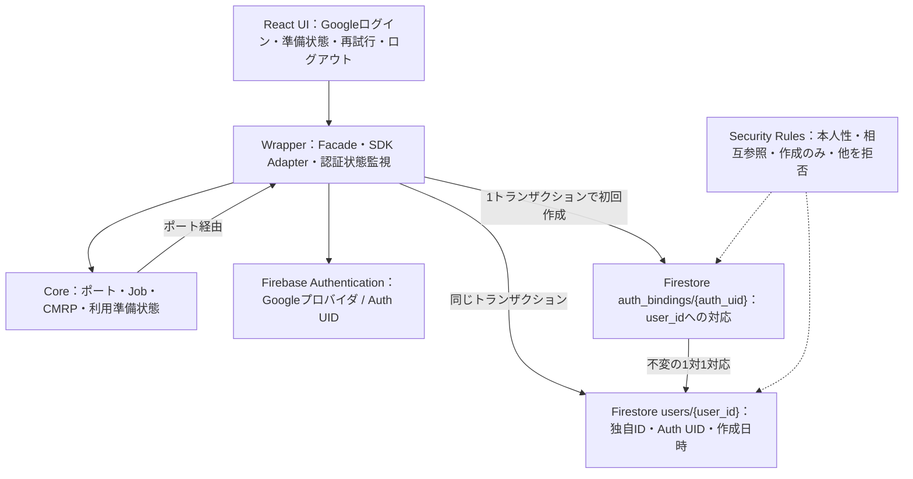

# ThemeDialogueAI 初期アーキテクチャ

> 公開用資料：旧履歴の識別子や内部参照を省略しています。記載日当時の仕様・計画・実験記録であり、現在の実装範囲と検証手順はREADMEを参照してください。

目的：基本要求を実現するための構成、データの概念、処理のつながりと技術方針を共有する。

対象範囲：システム構成、データ構造、処理フロー、技術的な設計方針。機能の受け入れ基準は [REQUIREMENTS.md](REQUIREMENTS.md)、開発体制・工程は [DEVELOPMENT_PLAN.md](DEVELOPMENT_PLAN.md) に記載する。

基準日：2026-10-28。概念設計を示す。物理スキーマや実行環境を確定するものではなく、未決定事項を実装上の決定と解釈しない。

2026-10-28のEXP-002準備で、認証・初期ユーザーマスタに限り構成と物理構造を決定した。現行設計は末尾と [AUTHENTICATION_DESIGN.md](AUTHENTICATION_DESIGN.md) を参照する。上記の概念設計という位置づけと各節の未決定記載は、それ以外の範囲に引き続き適用する。

## システム構成

| 要素 | 役割・方針 | 確定状況 |
| --- | --- | --- |
| 対話インターフェース | テーマ・発言の入力と応答の提示 | UI技術、対象端末は未決定 |
| 対話・解析処理 | 目的・方向性、辞書、関連、履歴を参照し、応答と解析を扱う | 実行場所、コンポーネント分割は未決定 |
| Gemini API | AI機能に利用する技術方針 | モデル、呼び出し方式、解析と応答生成の分担は未決定 |
| Firebase / Firestore | アプリ基盤とデータ永続化に利用する技術方針 | Firestore以外のFirebaseサービス、構成、リージョンは未決定 |
| GitHub Privateリポジトリ | ソース・仕様のバージョン管理方針 | リモートの作成状況・公開範囲は本作業では未確認 |

論理的には「対話インターフェース → 対話・解析処理 → Gemini API」と「対話・解析処理 ↔ Firestore」の関係を想定する。直接呼び出しか中継処理を置くかは未決定。この構成は実行時のシステムを表し、開発担当AI間の連携とは別に扱う。

## データ構造（概念モデル）

以下は要求を表現する論理的な情報単位であり、Firestoreのコレクション名、フィールド名、型、参照方式は未決定。

| 情報単位 | 保持する内容 | 主なつながり |
| --- | --- | --- |
| 対話 | ユーザーが決めたテーマと継続対象の履歴 | 発言、主体性キーワード、関連する辞書情報 |
| 発言 | 発言内容、発言者、対話内の順序・時点を識別する情報 | 対話、解析結果の発言根拠 |
| 主体性キーワード | 対話の目的・方向性を保持する語・情報 | 対話、辞書との対応方式は未決定 |
| 可変辞書の項目 | 動的に追加・更新するキーワードとその情報。ユーザーの感想も対象 | キーワード間の関連、元の発言との対応方式は未決定 |
| キーワード間の関連 | 関連するキーワード同士と関連情報 | 辞書の項目 |
| 気持ち履歴 | 主体、対象、気持ち、時点、発言根拠、およびAI推定／ユーザーの明示的表現の区別 | 対話、根拠となる発言、辞書との対応方式は未決定 |

辞書の種類を閉じた固定列挙に限定しない。感想や気持ちは扱う情報の例であり、辞書全体をその種類だけに制限しない。気持ち履歴の「時点」の表現と発言の保存時刻との関係は未決定。情報が不明なときに推測値を確定値として補完する設計は採用決定していない。

## 処理フロー（論理）

1. ユーザーがテーマを指定する。継続対話では保持した対話履歴と目的・方向性を参照する。
2. 発言を受け取り、対話履歴の保持対象とする。
3. 発言から辞書の追加・更新対象、感想、キーワード間の関連を扱う。確定条件は未決定。
4. 気持ちらしいキーワードの出現を検出した場合、気持ちの解析を開始する。検出手段とGemini APIへの処理分担は未決定。
5. 気持ち履歴として主体・対象・気持ち・時点・発言根拠を扱い、AI推定とユーザーの明示的表現を区別する。
6. テーマ、目的・方向性、辞書、履歴を参照して対話を継続し、後の再開に必要な情報を保持する。

上記は依存関係を示す。応答生成・保存・解析の実行順序、同期／非同期、処理単位は未決定。トリガーの検出だけでAI推定がユーザーの明示的表現になることはない。

## 技術的な設計方針

- AI解析結果と発言根拠の対応、および推定／明示の区別を保存・取得時にも維持する。
- 継続対話で目的・方向性と履歴を参照できる永続化を設計する。Gemini APIに渡す履歴の選択・要約方法は未決定。
- 個人の発言・感想・気持ちを扱うため、実装前にアクセス制御、秘密情報管理、保存と外部API送信の範囲を設計する。具体方式は未決定。
- API呼び出しや保存の失敗への対応は実装前の設計対象とし、本書では方式を確定しない。

## 未決定

- 言語、フレームワーク、ホスティング、サーバーの有無と実行境界。
- Geminiモデル、SDK、プロンプト、出力形式、検出方式と解析範囲。
- Firestoreの物理スキーマ、ID、索引、参照・非正規化方針、更新履歴。
- 辞書の共有範囲、ユーザー／テーマ／対話ごとのデータ境界。
- 認証・認可、Firestoreルール、APIキー管理、外部送信時の情報制御。
- 時点・不明値の表現、推定と明示が混在する結果の保存方法。
- 同時更新、再試行、重複防止、保存整合性、障害時の復旧。
- 保存期間、削除・訂正方式、バックアップ、監視、性能・費用の設計値。

## 追加設計：ユーザー・会話・発言と情報帰属の論理関係

追加基準：2026-10-28、コミット （公開版では履歴IDを省略）。REQUIREMENTS.mdのR-10〜R-15に対応する。既存の概念モデルを維持し、ユーザーの一意識別、会話・発言の識別、情報の帰属先と出典の区別を補う。既存節で未決定としていたID・参照について、以下の論理的な名称と関係を追加する。物理的な保存方法は引き続き未決定。

図は論理的な関係のみを示す。矢印はFirestoreの参照型やデータ配置、人数・件数の制約を指定しない。気持ちの対象は人物に限定しない。登場人物はユーザーマスタへの登録を必須とせず、発信者・帰属先・気持ちの主体とはそれぞれ別の概念として扱う。

### 識別情報と役割

| 論理的な情報 | 意味・関係 |
| --- | --- |
| ユーザーマスタのユーザー識別子 | ユーザーを一意に識別する。プロフィールの詳細と認証情報との対応は未決定 |
| `owner_user_id` | 対話履歴、辞書、気持ち履歴などの情報の帰属先となるユーザーを指す。発信者や気持ちの主体を意味しない |
| `conversation_id` | 一連の対話を識別する。ユーザーとの関係を保持し、各発言が属する会話をたどれるようにする |
| `message_id` | 個々の発言を識別する。根拠発言の参照先となる |
| `sender_id` / `sender_type` | 誰が発信したかとその種別を表す。少なくともユーザーとAIを区別する。AIをユーザーマスタに登録する仕様は定めない |
| `source_message_id` | 辞書や気持ち履歴などの情報の根拠となった発言を指す。発言から `conversation_id` をたどり、出典会話を識別する |
| 言及された人物 | 発言の内容に登場する人物。ユーザーマスタへの登録は必須ではなく、具体的な識別方法は未決定 |

### 既存処理フローへの追加条件

- 発言の保持時に、会話と発言を識別し、発信者を区別する。ユーザーと会話の関係、および対話履歴の帰属先を保持する。
- 辞書・気持ち履歴の登録・更新時に、帰属先と根拠発言を対応づける。根拠発言の発信者と出典会話を追跡できるようにする。
- 発信者だけで情報の帰属先や気持ちの主体を決めない。AIの発言を、ユーザー本人が明示した感想として扱わない。AIによる推定とユーザーの明示的表現の区別を維持する。
- 気持ち履歴では既存の主体・対象・気持ち・時点・発言根拠を維持する。`owner_user_id` や `sender_id` で主体・対象を置き換えない。
- 保存、取得、継続対話の文脈参照でユーザー間の情報を混在させない。権限管理の具体方式は未決定。
- 可変辞書の種類、追加・更新、キーワード間の関連、感想の登録、解析トリガーの既存方針を維持する。

### 追加設計の未決定事項

- ユーザー識別子と各IDの形式・生成方法、認証との対応、プロフィール項目、ユーザー登録画面。
- ユーザーと会話の関係の表現・参加人数・役割、権限管理と情報分離の実装方式。
- AI発信者の識別単位と発信者種別の具体値、登場人物の識別・同定・参照方式。
- 複数の根拠発言、出典のない情報、出典削除・訂正時の整合性の扱い。
- 共有・帰属変更の条件、会話をまたぐ情報の参照方式。
- Firestoreの具体的なコレクション構造、フィールド型、索引、参照方式、IDの保存場所。本節の論理名はこれらを確定しない。

## EXP-002準備：認証と初期マスタの構成決定

基準コミット：（公開版では履歴IDを省略）。初期プロトタイプはReact＋TypeScriptのWebクライアントとFirebase Web SDKを使い、GoogleログインとFirestoreの初期ユーザーマスタを扱う。アプリ専用サーバー、Admin SDK、Cloud Functions、Gemini API呼び出しはこの段階では導入しない。ローカル開発のビルド基盤はViteとする。これは今回の最小構成の設計決定であり、EXP-001の原文を採択済みに書き換えるものではない。

- 認証はFirebaseが行い、Auth UIDはアプリuser_idと別に保持する。独自IDの候補はFirestore SDKの自動ID生成を使い、UID・メール・表示名から合成しない。
- Auth完了後にマスタを初期化する。AuthとFirestoreの原子性は主張せず、Auth済み・準備未完了を正常な回復可能状態とする。Firestoreの2文書だけを原子的に作成する。
- 初期化ポートはUID固定の対応文書をトランザクションで読み、既存なら対応先マスタを検証して返す。未登録なら候補user_idのマスタと対応文書を同時作成する。競合時はSDKの再実行で既存の正規user_idを採用する。
- ブラウザーのCoreは権限の信頼境界ではない。Rulesで本人のGoogle認証UID、作成フィールド、変更不能な対応、`getAfter()` による相互参照を強制する。初期版はプロフィール更新・削除・一覧取得をすべて拒否する。
- `owner_user_id` とユーザー発言の `sender_id` はアプリuser_idへ接続する。会話・発言・辞書・気持ち履歴の要求は維持し、今回これらのコレクションは実装しない。
- Core／Wrapper／Jobの工程、状態、失敗契約、Rulesの不変条件、データ項目、実装後の必須試験は [AUTHENTICATION_DESIGN.md](AUTHENTICATION_DESIGN.md) を正とする。

### この段階の未決定・後続設計

Firebaseプロジェクト、所在地、許可ドメイン等の環境値は [FIREBASE_SETUP.md](FIREBASE_SETUP.md) で担当と確認条件を示す。会話以降の物理構造、共有・権限拡張、プロフィール編集、削除・統合・退会は未決定。認証と初期マスタ以外の既存の未決定事項は維持する。
