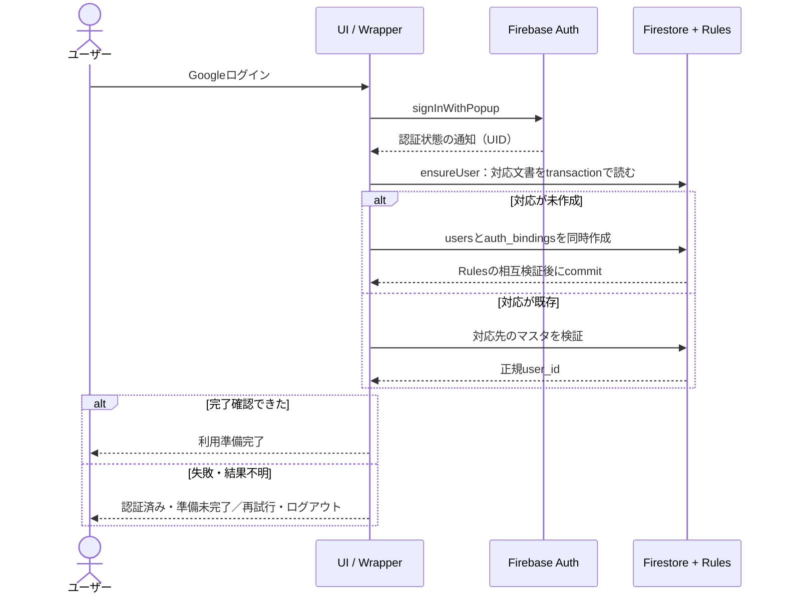

# Googleログイン・ユーザーマスタ初期化設計

> 公開用資料：旧履歴の識別子や内部参照を省略しています。記載日当時の仕様・計画・実験記録であり、現在の実装範囲と検証手順はREADMEを参照してください。

目的：EXP-001の指摘を受け、Firebase標準機能を利用して安全かつ最小の登録・ログイン構成を確定し、EXP-002実装の判断基準とする。

対象範囲：Google認証、独自user_idとの対応、初期マスタ、Rules、失敗と再試行、Core／Wrapper／Job、必須試験。会話・辞書・気持ち解析の実装、クラウド設定操作、デプロイは対象外。

決定日：2026-10-28。基準コミット：（公開版では履歴IDを省略）。ユーザーの今回の基本方針に従う。本文は設計決定であり、実装・Rules試験・実Google接続の成功を示すものではない。要求は [REQUIREMENTS.md](REQUIREMENTS.md)、構成概要は [ARCHITECTURE.md](ARCHITECTURE.md)、実施順序は [DEVELOPMENT_PLAN.md](DEVELOPMENT_PLAN.md) に対応する。

## 1. 採用する最小構成

- React＋TypeScript＋ViteのWebクライアント、Firebase Web SDKのモジュラーAPI、Firebase AuthenticationのGoogleプロバイダ、Firestore Standardの `(default)` データベースを使用する。
- Firebase SDKがGoogle認証・セッションを管理する。Googleログインを初回登録にも再ログインにも使う。認証後のユーザーマスタ初期化がアプリ側の登録に相当する。
- Auth UIDと独自user_idは別の識別子とする。ユーザーマスタとその対応文書をFirestoreの1トランザクションで作成する。
- 初期版はユーザーマスタの作成と本人の直接取得のみ。プロフィール入力・更新・削除・一覧取得、管理者権限、最終ログイン日時の記録は導入しない。
- 専用バックエンド、Admin SDK、カスタムトークン、Cloud Functions、Auth作成トリガー、独自パスワード管理、予約索引、永続ジョブ・補償基盤は導入しない。
- 認可はFirestore Security Rulesが強制する。ブラウザーのCoreやUIは信頼境界ではない。Rulesの相互参照検査を実装・テストできることが実装完了条件。

## 2. EXP-001指摘の整理

元の EXP-001/REVIEW.md（評価記録は公開対象外） は変更しない。以下の「対応」は設計上の対応であり、動作検証は全件未実施。

| 指摘 | 今回の対応 | 実装時の確認 |
| --- | --- | --- |
| F-01：UIDとuser_idの混同 | UID固定の対応文書と独自IDのマスタに分け、変更不能とする | 他者UID、対応差し替え、同一UIDの2個目マスタを拒否 |
| F-02：Auth／Firestoreの原子性 | Authは維持し、Firestoreの2文書だけを原子的に作成。未準備状態から同一UIDで再開 | 競合・切断・応答消失・再読み込みでも正規IDが1つ |
| F-03：仮想メール | 採用せずGoogle認証へ変更。Googleのアカウント回復を使い、アプリにリセット機能を自作しない | パスワード・仮想メール経路がないこと |
| F-04：ニックネーム一意性 | ログイン識別子として使わず、一意索引を作らない | 同じ表示名の別Googleユーザーを別IDで扱う |
| F-05：アクセス・権限 | 本人getと2文書同時createだけを許可し、他は拒否 | Rules単独の不正リクエスト試験 |
| F-06：自前ハッシュ | 採用しない | Firestore／クライアントにパスワード・ハッシュ・独自認証トークンがない |
| F-07：Jobの失敗契約 | Authログインとマスタ初期化を分け、外部副作用はrecord。確定結果とcleanup警告を分離 | Post・cleanup失敗で初期化を二重実行しない |
| F-08：秘密の消去保証 | 資格情報をアプリが収集しない。SDKの内部メモリー消去は保証しない | トークン・資格情報をログ／永続独自ストアへ出さない |
| F-09：未決定の確定扱い | 本文の最小構成を今回採用。将来項目は保留し、入力にない人物・気持ち情報は補わない | 変更範囲と既存R-01〜R-15の維持 |

## 3. IDと保存データ

### 不変条件

1. 初期版ではAuth UIDとアプリuser_idは1対1。1つのUIDに1つの対応文書と1つのマスタだけを許可する。
2. user_idはFirestore SDKが生成する自動ドキュメントID（20文字の英数字）を使う。認証UID、メール、表示名から導出しない。候補の生成自体はサーバー書き込みではない。
3. 生成候補は衝突しないと断定しない。既存マスタへの更新をRulesで拒否するため、衝突時に他者のマスタを上書きできない。
4. 対応とマスタは初回の同一トランザクションでのみ作成し、初期版では変更・削除不可。再ログイン時もcreated_atやuser_idを書き換えない。
5. `owner_user_id` とユーザー発言の `sender_id` は確認済みuser_idに対応する。Auth UIDとGoogle表示名は、会話の帰属・発信者・言及人物の代わりにしない。

### 初期版で確定する物理構造

| 文書 | フィールド（これ以外は許可しない） | 用途 |
| --- | --- | --- |
| `auth_bindings/{auth_uid}` | `user_id: string`、`created_at: Timestamp`、`schema_version: 1` | 認証UIDから正規のアプリuser_idを解決する |
| `users/{user_id}` | `user_id: string`、`auth_uid: string`、`created_at: Timestamp`、`schema_version: 1` | アプリの最小ユーザーマスタ |

created_atは両文書でサーバータイムスタンプを使う。Rulesでは作成要求時刻との一致を確認する。user_idはパスとフィールドで一致させる。メール、表示名、写真、Googleのアクセストークン、IDトークン、パスワード、role、statusはFirestoreへ保存しない。表示名は必要ならAuthが返す値をエスケープされたテキストとしてUIに表示するだけにする。

会話・辞書・気持ち履歴の物理構造はこの決定に含めない。これらは初期版のRulesで拒否し、将来機能ごとの設計・認可試験なしに開放しない。

## 4. Googleログインと初期化フロー

### 認証

- `GoogleAuthProvider` と `signInWithPopup` を使う。追加のGoogle APIスコープは要求しない。アプリ独自のOAuth処理やトークン検証を作らない。[S1]
- ポップアップ起動はユーザーのクリックに直接結びつける。Facade・Jobは起動前に通信等のawaitを挟まない。起動前に必要なSDK・永続化設定はアプリ初期化で完了し、完了までボタンを無効にする。
- 認証の永続化は `browserSessionPersistence` とし、同一タブの再読み込みから復元できる構成にする。独自のlocalStorageトークン保存はしない。複数タブ・端末からの同じUIDの初期化にも耐える。[S4]
- `onAuthStateChanged` を認証状態の入口とし、ログインAPIの戻りと監視イベントから二重にUIを確定しない。監視開始・解除はWrapperが管理する。
- ポップアップキャンセルはユーザー操作の中断として扱う。自動で再度ポップアップを開かない。遮断・非対応ブラウザーではエラーと再操作案内を表示する。リダイレクト方式は初期版に混在させず、必要なら後続変更とする。

### Firestore初期化ポート：ensureUser

1. SDKから取得した現在のAuth UIDを要求の主体として固定する。入力フォームからUIDやownerを受け取らない。
2. 候補user_idの参照はトランザクションコールバックの外で1回生成する。1回の呼び出しの内部再試行では同じ候補を使う。
3. トランザクションで `auth_bindings/{uid}` を読む。本人の存在しない対応文書へのgetもRulesで許可し、初回判定を可能にする。
4. 対応が既存なら、そのuser_idの `users` を同じトランザクションで読み、相互参照・型・schema_versionを確認して返す。ここでは書かない。
5. 対応がなければ、新規候補のusersとauth_bindingsを同時に書く。未存在の候補usersへの事前読み取りは行わない（他者文書を読む許可を要しないため）。既存IDへのsetは更新になりRulesで拒否される。上書きで衝突解決しない。
6. 競合ではSDKがコールバックを再実行し、勝者が作った対応を読み、敗者は自分の候補を保存せず正規user_idを返す。Auth操作やUI更新はコールバック内に置かない。[S2]
7. SDKの成功応答と整合したマスタ取得を確認して利用準備完了にする。キャッシュの存在だけでreadyにしない。オフラインの初期化は失敗として再操作を案内する。

## 5. Security Rulesの実装契約

RulesソースはEXP-002で実装・エミュレーター試験する。今回は設定変更・Rulesコード作成を行わない。APIキーやUIの非表示を認可の代用にしない。次の全条件を満たすこと。[S3][S6]

| 操作 | 許可条件 |
| --- | --- |
| 全体共通 | 認証済みで `request.auth.token.firebase.sign_in_provider` が `google.com`。予期しないプロバイダは拒否する |
| binding get | パスのuidが認証UIDと一致。初回判定の未存在getも許可。存在する文書へのアクセスは本人だけ |
| users get | 文書のauth_uidが認証UIDと一致し、本人のbindingがこのパスのuser_idを指す。両者のschemaとID対応が一致 |
| binding create | パスuidは本人。正確な許可フィールド・型・schema_version・サーバー時刻を検証。user_idの形式を検証し、getAfterで対応先usersのauth_uidが本人、user_idが一致、作成時刻・schemaも一致すること |
| users create | auth_uidは本人、user_idは文書IDと一致し形式・フィールド・型・schema・時刻を検証。操作前の本人bindingは存在しないこと。getAfterで本人bindingがこのuser_idを指し、作成時刻・schemaが一致すること |
| update / delete / list | 両コレクションとも拒否。本人にも許可しない |
| その他すべてのパス | 初期版は拒否。広いcatch-allのallowを追加しない |

片側だけのcreate、別UIDの対応、既存bindingがある状態の追加マスタ、role等の余分なフィールドの注入、既存IDへの上書きは拒否する。`getAfter()` で同時書き込み後の相互整合を強制し、クライアントが正しい関数を呼ぶという前提に依存しない。[S3]

リクエスト内の参照回数がRules上限内に収まるようにする。Admin SDKやコンソールの管理操作はRulesを迂回し得るため、最小版はアプリへ管理資格情報を持ち込まない。将来のサーバー導入時はIAMとサーバー認可を追加設計する。[S3][S6]

Rulesの必須試験でこの契約を満たせない場合、簡略化のために公開ルールへ変更しない。原因と代案をCodexへ返し、実装の完了を保留する。

## 6. 状態・失敗・再試行

アプリの状態はAuth認証とマスタ初期化を分ける。画面は認証復元中、未認証、認証操作中、マスタ準備中、準備失敗、利用準備完了を区別する。Auth成功だけで業務利用可能にしない。

| 状況 | 動作 |
| --- | --- |
| Auth失敗・キャンセル | マスタを作らず、キャンセルと設定・通信エラーを区別して案内 |
| Auth成功・マスタ未作成 | 認証を維持し、同じUIDでensureUserを実行 |
| トランザクション競合 | Firebase SDKの標準再試行を使う。アプリ独自の無限リトライを作らない |
| unavailable・オフライン・SDKの再試行終了 | 準備失敗を表示し、接続回復後のユーザー操作で同じUIDを再試行。短時間の自動再試行ループは追加しない |
| 応答消失・書き込み結果不明 | 成功扱いせず、同じUIDの対応を改めてtransactionで確認。候補が変わっても既存の正規IDを採用 |
| permission-denied・invalid schema・対応先欠損 | 操作を止めて設定／データ不整合エラーとして報告。別IDへの付け替え・片側修復・Auth削除・無限再試行をしない。管理者の調査対象 |
| Authだけ作成済みのまま終了 | 許容する未準備状態。次のログイン／同一タブ再読み込みでensureUserを実行。独自補償削除はしない |
| Post・cleanup失敗 | マスタ確定結果を維持して別の警告とする。表示更新の再試行でユーザー作成を繰り返さない |
| ログアウト・UID切り替え | 直ちにアプリuser・準備完了を破棄。SDK signOut失敗は明示して再操作可能にし、未完了の旧Job結果を表示しない |

認証の各変更に世代番号を付け、同じUID・世代のensureUserは同一実行へまとめる。完了時にも現在のUID・世代と一致するか確認して公開する。マスタのトランザクションがログアウト後に確定しても、旧ユーザーの結果をUIへ戻さない。権限はRulesが別途強制する。

メールやGoogle表示名が同じでもUIDが別なら別ユーザー。Authアカウントを削除して再作成した場合は新UIDとなり、メール一致で旧user_idを再割当てしない。管理者による不正な片側削除等は通常の再試行で隠さず、fail closedで扱う。

## 7. Core／Wrapper／Job（CMRP）

### 構成・ポート

- Core：`AppUser`、`AuthIdentity`、アプリ準備状態、Job基底、GoogleSignInJob、EnsureUserJob、SignOutJob、業務エラー。FirebaseのUser・Timestamp・例外型を公開契約へ持ち込まない。
- Coreのポート：`AuthPort`（Googleログイン・現在の認証状態・ログアウト）、`UserRepository`（ensureUser）。独自暗号・認証・汎用分散Jobのポートは作らない。
- Wrapper：FirebaseAuthAdapter、FirestoreUserRepository、AuthWrapper（UI向けFacade・DI・状態監視・世代管理）。自動ID生成・トランザクション・サーバータイムスタンプはRepository Adapter内部の技術詳細。
- UI：ログイン、準備中、再試行、ログアウト、最小のログイン済み表示。Auth監視の状態を表示する。Firebaseへ直接アクセスしない。Google表示名はHTML挿入しない。

### 工程の確定

工程順はprepare→collect→make→record→post、cleanupは成功・失敗にかかわらず実行。不要な工程はno-opでよく、すべてを抽象メソッドとして形式的に埋めさせない。

| 工程 | GoogleSignInJob | EnsureUserJob | SignOutJob |
| --- | --- | --- | --- |
| prepare | SDK準備済み・多重起動防止を同期確認 | UID・世代を固定 | 呼び出しの確認 |
| collect | no-op（ポップアップ前にawaitしない） | 現在の認証主体を確認。DBのread/modify/writeはRepositoryにまとめる | no-op |
| make | Google認証要求を組み立てる純粋処理 | 初期化要求を生成する純粋処理 | ログアウト要求を生成 |
| record | AuthPortのGoogleログイン。セッションもここでSDKにより成立 | RepositoryのensureUser。DB収集と確定の一体性をtransaction内に保つ | AuthPortのsignOut。UI側の旧状態破棄は呼び出し時に先行 |
| post | 資格情報を含まない操作結果。監視イベントからの準備完了を待たず、ログイン操作成功と区別 | 確定したAppUserを返す。Wrapperが世代確認後にreadyを公開 | UIへ操作結果 |
| cleanup | 操作中フラグ等の解放 | 一時参照の解放 | 一時参照の解放 |

collectで先にDBを読み、その結果を後から別transactionで確定する分割はしない。CMRPはSDKが保証する整合性を壊して分割する規則ではない。GoogleSignInJobはprepare〜recordのポップアップ起動まで非同期境界を作らず、SDKのPromiseを得てから待つ実行契約とする。

recordはvoidではなく確定結果を返す。Resultは成功値または秘匿化した業務エラーに、必要に応じて主操作の確定状態・cleanup警告を付ける。確定状態はconfirmed／not-confirmed／unknownを区別し、Auth成功とマスタ未準備を同じ成功値にしない。cleanup例外は独立して捕捉し、既存の主結果を上書きしない。postで例外になってもrecord確定済みという情報を保持する。トークン・生SDK例外・個人情報をResult／ログへ流さない。

### 道場システムとの関係

別システムの6工程Job基底と、DAOを注入するApplicationの構造を参考にした。参照元コードは同梱しない。Firebase向けの非同期・Rules・世代管理の契約は本書で定める。

## 8. 実装完了に必要な試験

全件未実施。EXP-002では以下の結果と実行コマンド・対象コミットを提出する。

| ID | 試験 | 合格条件 |
| --- | --- | --- |
| A-01 | 初回・再ログイン・同一タブ復元 | 初回2文書、以後同じID。再ログインで書き換えない |
| A-02 | 同UIDの同時初期化・別タブ・別端末相当の並行要求 | users/bindingが各1つ。全要求の返値が正規user_id |
| A-03 | 書き込み前拒否、オフライン、SDK再試行終了 | 準備失敗となりreadyにならない。手動再試行可 |
| A-04 | commit済みだが応答消失を模擬、再起動 | 次回ensureで同じID。Auth削除と追加マスタなし |
| A-05 | 未認証・異なるUID・google.com以外のトークン | 両コレクションの不正get/create/list拒否 |
| A-06 | 本人の未存在binding get | 許可され、初回作成が可能 |
| A-07 | 片側create、相互参照不一致、時刻・型・schema不正、余分なフィールド | すべて拒否。role等の注入も不可 |
| A-08 | 既存binding差し替え、2個目users作成、既存IDへのset、全update/delete/list、その他パス | すべて拒否。本人にも許可しない |
| A-09 | A→B切替・準備中ログアウト・旧Job遅延完了 | Aの情報がBや未認証画面へ公開されない |
| A-10 | record成功後のpost例外、cleanup例外 | 主結果の確定状態を保持し、作成を二重実行しない |
| A-11 | 表示名同一の別UID、欠損・不整合な既存データ | 前者は別ID。後者はfail closedで自動付け替えなし |
| A-12 | ポップアップ成功・中断・遮断、signOut失敗、実ドメイン | 自動再ポップアップなし。設定済み実Google環境の確認は別許可後 |
| A-13 | ビルド・型検査・Core依存・秘密情報検査 | CoreにSDK／React依存なし。トークン・秘密鍵・パスワード保存なし |

Rules試験はAdmin SDKで全許可のまま通すのではなく、認証主体付きクライアント相当の `@firebase/rules-unit-testing` を使う。管理用のルール無効化は不正データの準備等に限定し、評価対象操作には使わない。[S5] Auth／Firestoreエミュレーターを同じdemoプロジェクトで使い、実クラウドへフォールバックしない。エミュレーターのGoogle相当認証は実Google OAuthの試験ではない。[S7]

## 9. 保留する改善と残る環境値

| 項目 | 今回の扱い・再検討する契機 |
| --- | --- |
| プロフィール編集・表示名の永続化 | 対象外。追加時に許可フィールド・サイズ・XSS・個人情報を設計 |
| 退会・Auth削除・マスタ削除・移行・アカウント統合 | 未決定。公開運用前に保持・削除・復旧方針を決める。初期版は削除UI・自動統合なし |
| 管理者・共有・組織権限 | 未決定。初期版にroleや管理ルートを設けない |
| App Check・監視・運用上限 | 一般公開前に乱用対策・費用制御を評価。認証・Rulesの代わりにはしない |
| モバイル／iframe／制限ブラウザーのリダイレクト対応 | 初期版のポップアップ試験で対応範囲を確認。必要なら別変更 |
| user_idの再利用・複数プロバイダ | 対象外。新UIDを同じメールだけで自動統合しない |
| プロジェクトID、所在地、許可ドメイン、サポートメール、実アカウント制限 | 未決定／未確認。[FIREBASE_SETUP.md](FIREBASE_SETUP.md) で管理者が決める |

重大な認可違反・対応不整合・重複・旧ユーザー情報の露出は保留改善へ降格せず、実装完了前に修正する。

## 10. 一次資料

2026-10-28確認。上記のアプリ設計はこれらの機能を組み合わせた設計判断であり、実環境の成功保証ではない。

- [S1 Googleログイン](https://firebase.google.com/docs/auth/web/google-signin)
- [S2 Firestoreトランザクション](https://firebase.google.com/docs/firestore/manage-data/transactions)
- [S3 Rulesの条件・getAfter・参照上限](https://firebase.google.com/docs/firestore/security/rules-conditions)
- [S4 Authの永続化](https://firebase.google.com/docs/auth/web/auth-state-persistence)
- [S5 Security Rulesのテスト](https://firebase.google.com/docs/rules/unit-tests)
- [S6 フィールド制御・ドキュメント単位の読み取り](https://firebase.google.com/docs/firestore/security/rules-fields)
- [S7 Authenticationエミュレーター](https://firebase.google.com/docs/emulator-suite/connect_auth)
